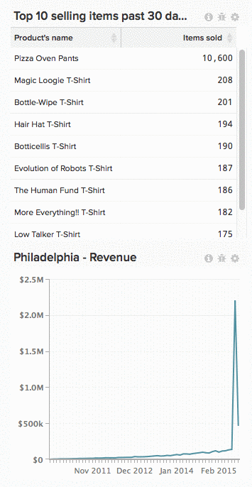

# 从功能板中删除图表

要从仪表板中删除图表，请单击图表右上角的齿轮（）图标，然后单击&#x200B;**[!UICONTROL Remove from Dashboard]**。

>[!NOTE]
>
>删除图表与[删除图表](../../data-user/dashboards/delete-chart.md)不同。 此外，可以随时将[图表读取到仪表板](../../data-user/dashboards/add-charts-dashboard.md)。

