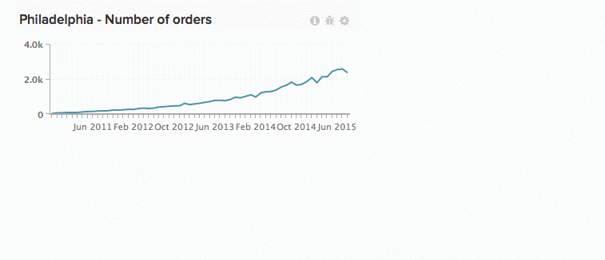

# 在仪表板中使用图表

标量数字。 条形图。 图表会延长较长时间。 每个图表显示信息的方式各不相同，这意味着图表的大小和位置并非一刀切的解决方案。 在[!DNL Commerce Intelligence]中，您可以调整图表大小并重新排列图表以创建理想的工作区。

*要调整图表大小*，请单击并拖动任何图表的右下角。

*若要移动图表*，请将光标悬停在图表顶部上直到显示`Move`光标。 单击并按住，然后将图表拖动到所需位置。 释放单击以放置图表。

