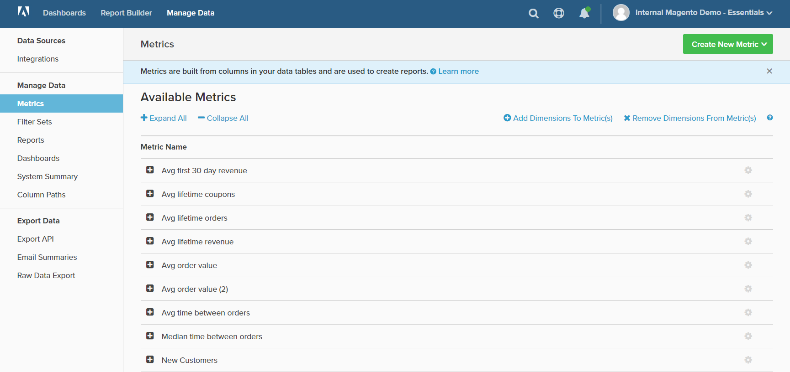

# 管理数据

“管理数据”提供对用于管理集成、报告和图表数据、功能板和导出的各种工具的访问。

## 要访问[!DNL Manage Data]：

1. 在菜单中，单击&#x200B;**[!DNL Manage Data]**。

1. 在侧边栏中，选择以下标题下需要的主题：

   * `Data Sources`
   * `Manage Data`
   * `Export Data`

   <!--{: .zoom}-->
